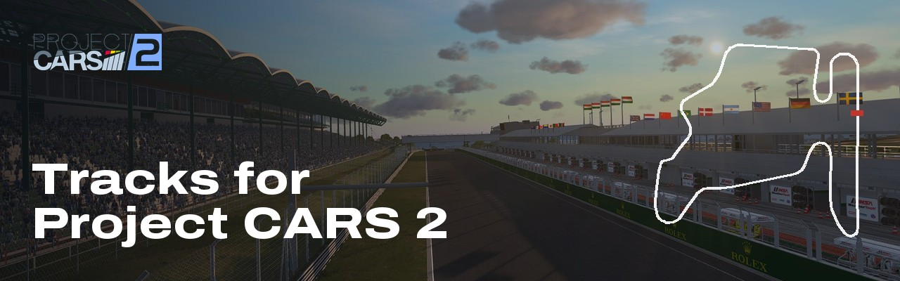

# PC2 Tracks

Assetto Corsa circuits converted for Project CARS 2 and rebuilt with PC2's own materials, lighting, AI and pit lanes.
Free to download and installed with JSGME.

**Download page: https://z0mb1xcat.github.io/pc2-tracks/**

## Tracks

| Track | Location | Version | Download |
| --- | --- | --- | --- |
| Hungaroring | Mogyoród, Hungary | 1.2 | [Hungaroring-for-PC2-v1.2.zip](https://github.com/Z0MB1XCAT/pc2-tracks/releases/download/hungaroring-v1.2/Hungaroring-for-PC2-v1.2.zip) (400 MB) |

Every version is also listed on the [Releases](https://github.com/Z0MB1XCAT/pc2-tracks/releases) page, with what changed.

## What you need

- Project CARS 2 on Steam
- JSGME (the mod manager) in your Project CARS 2 folder
- The "_Bootfiles for PC2" mod (V7.0.0.0 or newer) in your MODS folder

## Installing a track

1. Close the game and unzip the download anywhere.
2. Double-click `Install.bat`. It finds your game, copies the track into MODS and adds it to the track list.
3. Open JSGME and activate Bootfiles first, then the track. If you chose the optional HUD map, activate that last.

`Install.bat` runs a plain text PowerShell script (`tools\Hungaroring-Installer.ps1` in the download), so you can
read exactly what it does before running it. If you would rather install by hand, `READ ME FIRST.txt` in each
download has the manual steps.

To remove a track, deactivate it in JSGME and run `Uninstall.bat`.

## Found a problem?

[Open an issue](https://github.com/Z0MB1XCAT/pc2-tracks/issues/new/choose) and pick "Bug report". It asks for the
track version and what happened, which is usually all I need. Track suggestions are welcome there too.

## Credits

- Hungaroring: original Assetto Corsa track by racinjoe013.

These are fan-made conversions, free to download. Not affiliated with Slightly Mad Studios, Bandai Namco or Kunos
Simulazioni. Project CARS and its logo are trademarks of their owners, and the original track authors keep all
rights to their work.

## License

- **Code** (the website, the installer scripts and the preview tools) is under the [MIT License](LICENSE).
- **Tracks** (the downloads) are covered by the [track terms of use](TRACK-TERMS.md): anyone with a legal copy of
  Project CARS 2 can use them, but please link to the download page instead of re-uploading them.

Maintainer notes (adding tracks, updating the site) are in [MAINTAINING.md](MAINTAINING.md).
